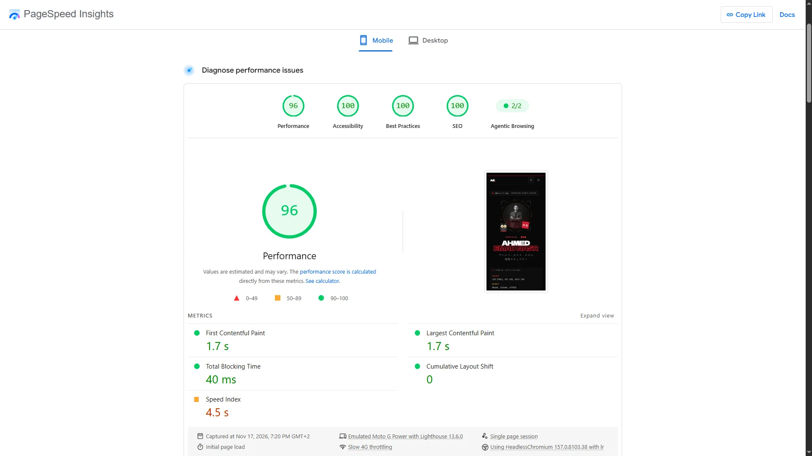
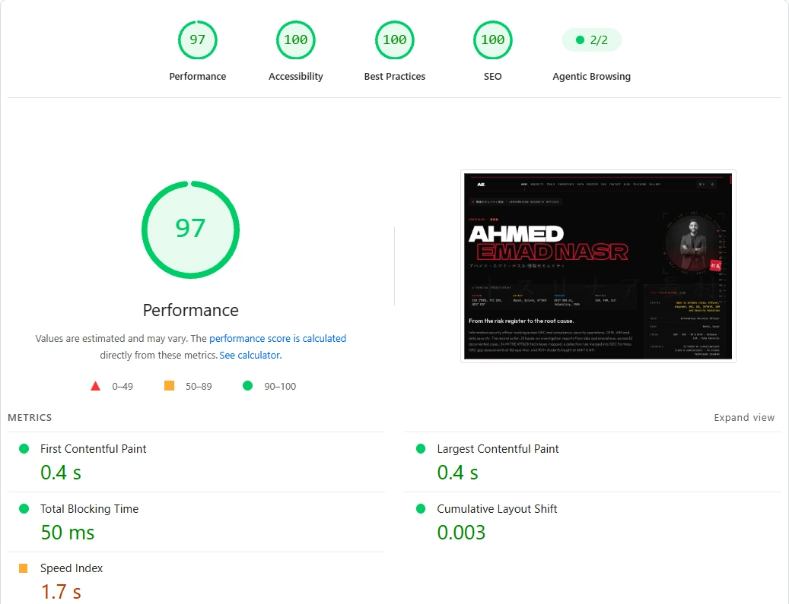
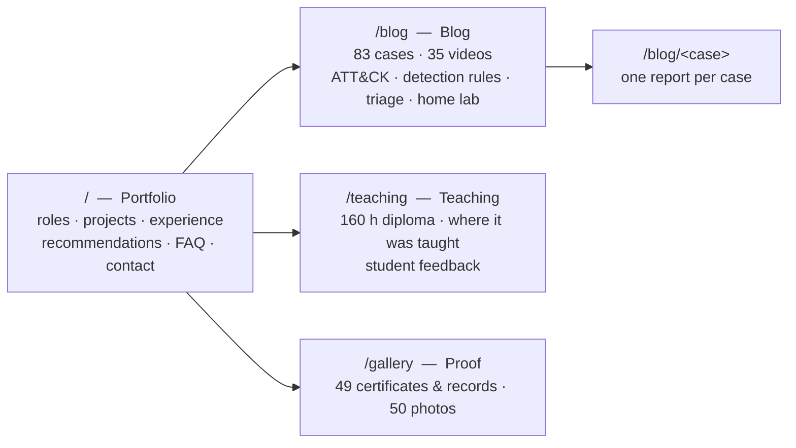
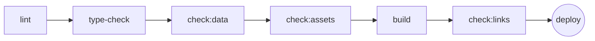

<div align="center">

<a href="https://ahmed-emad-nasr.github.io/ahmed.dev/">
  
</a>

# AHMED EMAD NASR

### Information Security Portfolio · Blog · Teaching · Proof

[](https://ahmed-emad-nasr.github.io/ahmed.dev/)

[](https://ahmed-emad-nasr.github.io/ahmed.dev/)
[](https://ahmed-emad-nasr.github.io/ahmed.dev/blog)
[](https://ahmed-emad-nasr.github.io/ahmed.dev/teaching)
[](https://ahmed-emad-nasr.github.io/ahmed.dev/gallery)

[](https://www.linkedin.com/in/ahmed-emad-nasr/)
[](https://www.youtube.com/@AhmedEmad-0x3omda)
[](https://tryhackme.com/p/Ahmed.Emad.Nasr)
[](mailto:ahmed.em.nasr@gmail.com)

[](#-pagespeed---report)
[](#-pagespeed---report)
[](#-pagespeed---report)
[](#-pagespeed---report)
[](./LICENSE)

</div>

---

## `> whoami`

```yaml
project    : ahmed.dev — the portfolio of Ahmed Emad Nasr (0x3omda)
role       : Information Security Officer · Cybersecurity Instructor (AMIT & NTI)
covers     : GRC · SOC · Incident Response & DFIR · Malware Analysis · IAM · Data Security
live       : https://ahmed-emad-nasr.github.io/ahmed.dev/
pages      : /  ·  /blog  ·  /blog/<case>  ·  /teaching  ·  /ar/teaching  ·  /gallery
built_with : Next.js 16 (static export) · React 19 · TypeScript · Tailwind CSS v4 · GSAP · Framer Motion
hosting    : GitHub Pages — no server, everything is built ahead of time
```

Not a static résumé: a **case library**. Every project connects the finding,
the evidence, the analysis, the response and the lesson — written so a
recruiter can follow it in plain words, with the reports, detection rules and
MITRE ATT&CK mapping underneath for the technical reader.

---

## `> pagespeed --report`

Measured with [PageSpeed Insights](https://pagespeed.web.dev/) on the live home page.
Lab scores vary by a few points between runs.

<table>
  <tr>
    <th align="center">📱 Mobile — 94</th>
    <th align="center">🖥️ Desktop — 97</th>
  </tr>
  <tr>
    <td></td>
    <td></td>
  </tr>
</table>

| Metric | Mobile | Desktop | What it means |
| :-- | :--: | :--: | :-- |
| Largest Contentful Paint | **1.8 s** | **0.4 s** | the main content is on screen |
| Total Blocking Time | **40 ms** | **50 ms** | the page never freezes while it loads |
| Cumulative Layout Shift | **0.005** | **0.003** | nothing jumps around |
| First Contentful Paint | 1.8 s | **0.4 s** | first pixels |
| Speed Index | 5.2 s | 1.7 s | held back on purpose by the intro screen and the entrance animations |

---

## `> ls /pages`



| Page | What is on it |
| :-- | :-- |
| [`/`](https://ahmed-emad-nasr.github.io/ahmed.dev/) | Hero, roles, services, projects, open source, tools, experience, the path, LinkedIn recommendations, training platforms, process, FAQ, contact |
| [`/blog`](https://ahmed-emad-nasr.github.io/ahmed.dev/blog) | Searchable library of **83** cases, **35** videos, **56** ATT&CK techniques mapped, **50+** custom Wazuh rules, a triage challenge, the home lab |
| `/blog/<case>` | Goal → what happened → what I did → how to prevent it → evidence, with the PDF report |
| [`/teaching`](https://ahmed-emad-nasr.github.io/ahmed.dev/teaching) | The 160-hour SOC & Cybersecurity Diploma module by module, where it was taught, **25** student notes quoted word for word, and a training request for teams |
| [`/cv`](https://ahmed-emad-nasr.github.io/ahmed.dev/cv) | The CV as a web page (from `data/cv.ts`), with the PDF download — indexable as "Ahmed Emad Nasr CV" |
| [`/videos`](https://ahmed-emad-nasr.github.io/ahmed.dev/videos) | Every YouTube video and playlist; each video also has its own page `/videos/<slug>` with `VideoObject` data |
| [`/attack`](https://ahmed-emad-nasr.github.io/ahmed.dev/attack) | Every MITRE ATT&CK technique the cases show, by tactic; each has its own page `/attack/<T-id>` with its cases, sub-techniques and tools |
| `/writeups/<platform>` | The write-ups of one platform — [TryHackMe](https://ahmed-emad-nasr.github.io/ahmed.dev/writeups/tryhackme), [PortSwigger](https://ahmed-emad-nasr.github.io/ahmed.dev/writeups/portswigger), [LetsDefend](https://ahmed-emad-nasr.github.io/ahmed.dev/writeups/letsdefend) |
| `/projects/<tool>` | A page per tool I wrote — [CyberSuite](https://ahmed-emad-nasr.github.io/ahmed.dev/projects/cybersuite), [WebP Converter](https://ahmed-emad-nasr.github.io/ahmed.dev/projects/webp-converter): what it does, how to run it, sample output |
| [`/training`](https://ahmed-emad-nasr.github.io/ahmed.dev/training) · [`/ar/training`](https://ahmed-emad-nasr.github.io/ahmed.dev/ar/training) | Training for teams, in English and Arabic (`hreflang`): who it is for, the formats, the diploma module by module, student quotes and a request button |
| [`/ar/teaching`](https://ahmed-emad-nasr.github.io/ahmed.dev/ar/teaching) | The same page in Arabic (right to left, Cairo font), linked to the English one with `hreflang` |
| [`/gallery`](https://ahmed-emad-nasr.github.io/ahmed.dev/gallery) | Degree, certifications, courses and records, photos from classrooms and events |

Operator tools on every page: `Ctrl / ⌘ + K` command palette · `?` keyboard
shortcuts · `g` + key to jump to a section · type `3omda` for the terminal.

---

## `> cat /ops/capabilities.txt`

| Domain | Focus |
| :-- | :-- |
| `GOVERN` | GRC, ISO 27001, PCI DSS, NIST CSF, risk and compliance |
| `DETECT` | Wazuh, Splunk, MITRE ATT&CK, custom rules, alert triage |
| `RESPOND` | NIST 800-61, Volatility, YARA, incident reporting |
| `INVESTIGATE` | DFIR, malware analysis, email analysis, timeline reconstruction |
| `PROTECT` | IAM, PAM, DLP, cloud security, data security |
| `TEACH` | SOC & Cybersecurity Diploma — CCNA, Linux, Security+, SEC450, labs |

---

## `> cat /stack.conf`


- **Static export.** `npm run build` writes plain HTML/CSS/JS to `out/`; GitHub Pages serves it.
- **Every section in the HTML.** Each section is its own `next/dynamic` chunk, but all of it is rendered ahead of time — every `#anchor` works and crawlers see the whole page. Long lists open with **Show more**.
- **Searchable by people and by Google.** Name-first titles and descriptions per page, one `<h1>` per page, JSON-LD (Person, WebSite, Blog, Course, ImageGallery, TechArticle, BreadcrumbList), sitemap with images and videos, RSS feed for the cases.
- **Accessible.** WCAG 2.2 AA checked with axe-core on every page kind, on phone and desktop, dark and light theme. Text scales with the browser's font size; reduced motion is respected.

See [ARCHITECTURE.md](./ARCHITECTURE.md) for routes, loading rules, code
splitting and asset ownership.

---

## `> make verify`

Every push to `master` runs the same gates in GitHub Actions before it deploys:



```bash
npm run lint          # ESLint
npm run type-check    # TypeScript, strict
npm run check:data    # every case, ATT&CK id, video id and date is consistent
npm run check:assets  # every image / PDF the data points at exists
npm run build         # static export to out/
npm run check:links   # every internal link in out/ resolves
npm run check:a11y    # axe-core, WCAG 2.2 AA (needs Playwright)
```

Or all of them at once: `npm run verify`.

Every Monday, `.github/workflows/links.yml` also builds the site and checks
every **outside** link (repos, videos, certificate pages, platforms); dead ones
are listed in one GitHub issue, *Broken external links*.

---

## `> ./quickstart.sh`

```bash
git clone https://github.com/Ahmed-Emad-Nasr/ahmed.dev.git
cd ahmed.dev
npm install
npm run dev          # http://localhost:3000
```

No environment setup: the deploy workflow reads the address from the
repository (`/ahmed.dev` here; the domain root if it is ever deployed from
`Ahmed-Emad-Nasr.github.io`) — see `.env.example` to test a sub-path locally. The contact form needs no setup: it
opens the visitor's mail app with the message filled in, with Gmail and
"copy message" as fallbacks.

**Adding a case, video, certificate or job:** [`HOW-TO-ADD.md`](HOW-TO-ADD.md)
(step by step) · [`AI-PROMPT.md`](AI-PROMPT.md) (a prompt for any AI
assistant — AI tools that open the repo read the same rules from `AGENTS.md`).

---

## `> tree -L 2`

```text
app/          routes: /, /blog, /blog/[slug], /teaching, /ar/teaching, /gallery, metadata, sitemap, feeds
components/
  layout/     navigation, theme, terminal, command palette, shortcuts, footer
  ui/         shared pieces: SectionHeader, CounterChip, ShowMore, kit
  home/       portfolio and teaching sections
  blog/       case library, filters, case pages, ATT&CK, detection rules
  gallery/    proof gallery and lightbox
data/         all site content, as typed TypeScript
lib/          routes (which section lives on which page), SEO, scrolling, performance
scripts/      asset generation and build checks
public/       images, reports, icons, service worker
screenshots/  README images
```

**Adding a case:** add it to [`data/cases.ts`](./data/cases.ts) → add its
screenshots → optional details and ATT&CK mapping → `npm run thumbs` and
`npm run og:cases` → `npm run check:data` and `npm run check:assets`.

**Moving a section to another page:** one line in `SECTION_PAGE`
([`lib/routes.ts`](./lib/routes.ts)) — the navbar, palette, shortcuts and old
links follow it.

---

## `> visual --telemetry`

<p align="center">
  
</p>

<p align="center">
  
  &nbsp;&nbsp;&nbsp;
  
</p>

---

## `> cat CREDITS LICENSE`

The Neo-Samurai design language and component structure are based on
[Sensei-Dev](https://github.com/MostafaSensei106/Sensei-Dev) by Mostafa
Mahmoud, licensed under GPL-3.0. The portfolio content is original and is not
covered by the GPL.

Two licenses — details in [CONTENT-LICENSE.md](./CONTENT-LICENSE.md):

- **Code** (`app/`, `components/`, `lib/`, `scripts/`, configs): [GPL-3.0](./LICENSE).
- **Content** (CV, reports, screenshots, photos, certificates and the written
  text in `data/`): © Ahmed Emad Nasr, all rights reserved.

Testimonials belong to their authors; fonts are under the SIL Open Font License 1.1.

<div align="center">

<br>

`SECURITY IS A PROCESS. EVIDENCE MAKES IT REPEATABLE.`

<sub>侍 · 0x3omda</sub>

</div>
